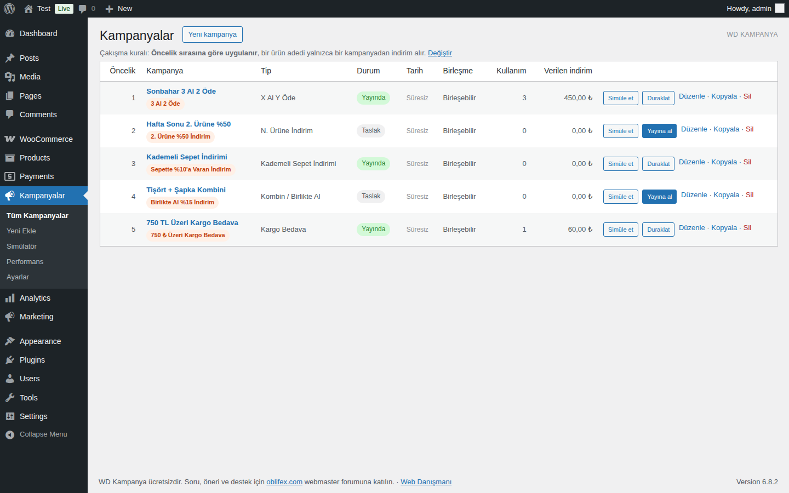
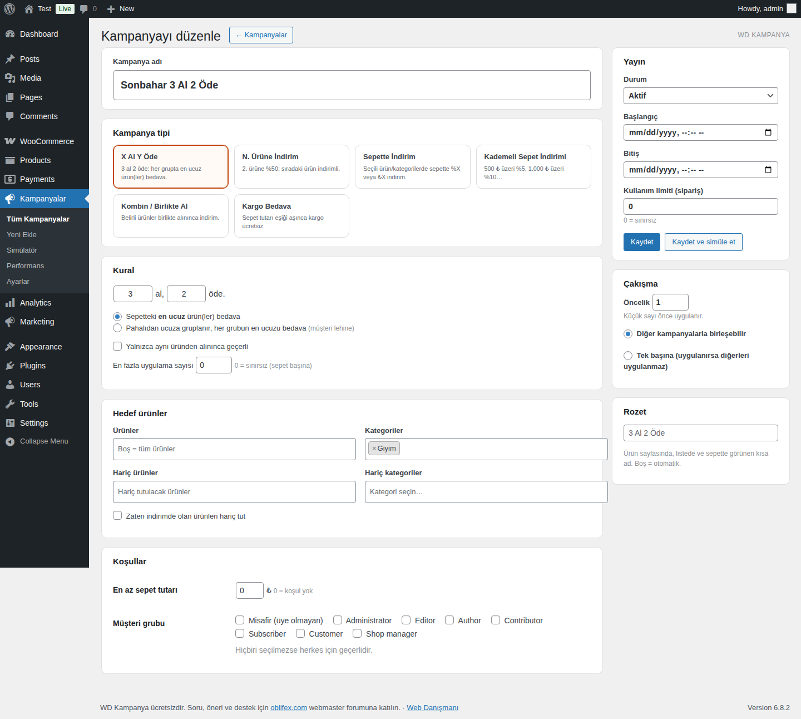
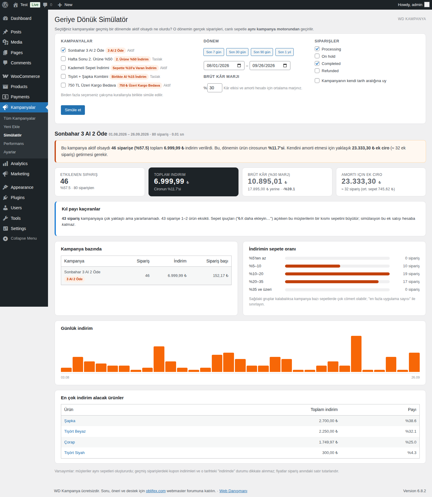
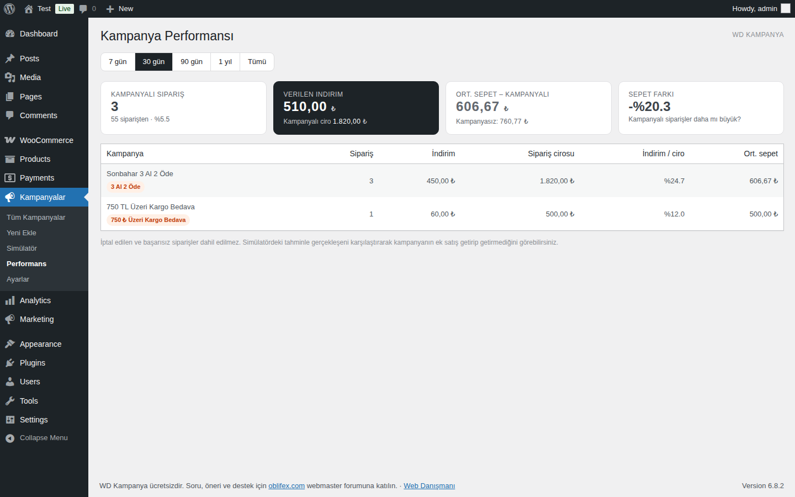
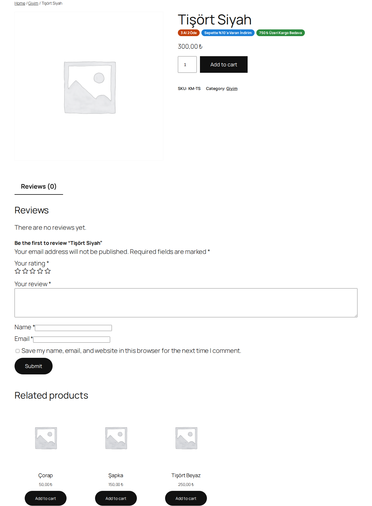
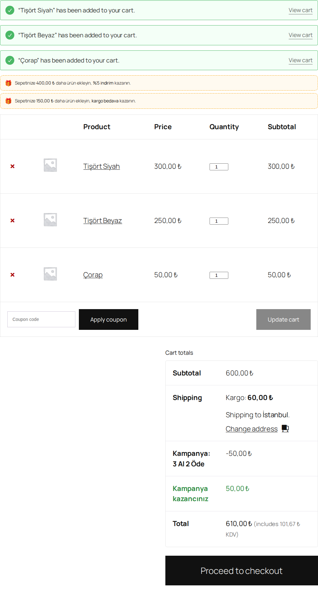

<div align="center">

# 🎯 WD Kampanya

**Kampanya motoru + geriye dönük simülatör (WooCommerce için)**

"3 Al 2 Öde", "2. ürüne %50", kademeli sepet indirimi, kombin, sepette %X ve kargo bedava kampanyalarını tek motorda yönetin. Yayına almadan önce **"bu kampanya geçen ay aktif olsaydı ne olurdu?"** sorusunun cevabını görün.

[](https://wordpress.org)
[](https://woocommerce.com)
[](https://php.net)
[](#)
[](LICENSE)
[](#)

### 💬 Destek ve daha fazla ücretsiz yazılım: **[oblifex.com](https://oblifex.com)**
Sorularınızı sorabileceğiniz, bu ve benzeri WordPress / WooCommerce yazılımlarını bulabileceğiniz sitemiz.

</div>

---

## Neden bu eklenti?

Kampanya eklentilerinin çoğu tek bir soruyu cevaplamaz: **"Bu kampanya bana kaça mal olacak?"**

WD Kampanya, kampanyayı yayına almadan önce geçmiş siparişleriniz üzerinde simüle eder:
- Kaç siparişe uygulanırdı?
- Toplam kaç lira indirim verilirdi?
- Brüt kârınız ne kadar erirdi?
- Kendini amorti etmesi için kaç ek sipariş gerekir?

Simülatör, canlı sepetle **aynı kampanya motorunu** kullanır; yani gördüğünüz sayı, kampanya gerçekten çalışsaydı hesaplanacak olanla aynıdır.

## Ekran görüntüleri

| Kampanyalar | Kampanya formu |
|---|---|
|  |  |

| Geriye dönük simülatör | Gerçekleşen performans |
|---|---|
|  |  |

| Ürün rozetleri | Sepet: indirim, ipuçları, kazanç |
|---|---|
|  |  |

## Kampanya tipleri

| Tip | Örnek | Nasıl çalışır |
|---|---|---|
| **X Al Y Öde** | 3 Al 2 Öde | En ucuz ürün(ler) bedava. İsteğe bağlı olarak pahalıdan ucuza gruplanır ya da yalnız aynı ürün sayılır. |
| **N. Ürüne İndirim** | 2. ürüne %50 | Her gruptaki en ucuz ürün indirimli. Tekrarlı veya tek sefer. |
| **Sepette İndirim** | Kategoride %20, adet başı 50 ₺ | Hedef ürünlere yüzde ya da tutar indirimi. |
| **Kademeli** | 500 ₺ üzeri %5, 1.000 ₺ üzeri %10 | Ulaşılan en yüksek kademe uygulanır. |
| **Kombin** | Tişört + Şapka %15 | Ürünlerin hepsi sepetteyse, her tam set için indirim. |
| **Kargo Bedava** | 750 ₺ üzeri | Eşik aşılınca tüm kargo seçenekleri ücretsiz. |

**Tüm tipler için:**
- **Hedefleme:** ürün, kategori (alt kategoriler dahil), hariç ürün/kategori, "zaten indirimde olanları hariç tut".
- **Koşullar:** en az sepet tutarı, müşteri grubu (misafir veya rol), başlangıç/bitiş tarihi, sipariş bazlı kullanım limiti.
- **Uygulama sınırı:** sepet başına en fazla uygulama sayısı.

## Çakışma kuralları

- **Öncelik:** Küçük sayı önce uygulanır.
- **Birleşme:** Her kampanya *birleşebilir* ya da *tek başına* olarak işaretlenir. Tek başına bir kampanya uygulanırsa diğerleri durur.
- **Genel mod:**
  - *Öncelik sırasına göre* uygula, ya da
  - *Müşteriye en avantajlısını* seç: birleşebilenlerin toplamı ile her tek başına kampanya karşılaştırılır.
- **Ürün başına tek indirim:** 3 Al 2 Öde'ye katılan ürüne ayrıca %10 sepet indirimi uygulanmaz.
- **Kupon politikası:** Kampanyalar kuponlarla birlikte geçerli olabilir ya da kupon varsa hiç uygulanmaz.

## Geriye dönük simülatör

Bir veya birden fazla kampanya (taslaklar dahil), bir tarih aralığı ve brüt kâr marjınızı seçin. Rapor şunları içerir:

- **Hüküm:** Kaç siparişe ne kadar indirim verilirdi ve bunun ciroya oranı.
- **Kâr etkisi:** Kampanyalı ve kampanyasız brüt kâr.
- **Amorti noktası:** Kampanyanın kendini ödemesi için gereken ek ciro ve ek sipariş sayısı.
- **Kıl payı kaçıranlar:** Eşiğe az farkla ulaşamayan siparişler ve ortanca eksik tutar (upsell potansiyeli).
- **Dağılımlar:** Kampanya bazında kırılım, indirimin sepete oranı, günlük indirim grafiği, en çok indirim alacak ürünler.

HPOS ve klasik sipariş depolama ile çalışır. Sorgular doğrudan veritabanından yapıldığı için on binlerce sipariş saniyeler içinde işlenir.

> Varsayım: Müşteriler aynı sepetleri oluştururdu. Kampanyanın yaratacağı ek talep hesaba katılmaz; bu yüzden rapor amorti noktasını ayrıca verir.

## Mağaza tarafı

- **Sepet satırı:** Her kampanya ayrı bir indirim satırı olarak görünür ("Kampanya: 3 Al 2 Öde −50,00 ₺"). KDV dahil ve hariç fiyatlarla doğru çalışır.
- **Kazanç satırı:** Sepet toplamlarında "Kampanya kazancınız" satırı.
- **Sepet ipuçları:**
  - "1 ürün daha ekleyin, 3 Al 2 Öde kampanyasından yararlanın."
  - "Sepetinize 150 ₺ daha ürün ekleyin, kargo bedava kazanın."
- **Rozetler:** Ürün sayfasında ve mağaza listesinde kampanya rozetleri. Kombinlerde diğer ürünlere bağlantı verilir.
- **Performans raporu:** Gerçekleşen kullanım; kampanyalı ve kampanyasız ortalama sepet karşılaştırması.

## Kurulum

1. Bu sayfadaki yeşil **Code → Download ZIP** düğmesiyle eklentiyi indirin (ya da [oblifex.com](https://oblifex.com)'daki paketi kullanın). Zip'i açmayın.
2. WordPress panelinde **Eklentiler > Yeni Ekle > Eklenti Yükle** ile zip'i yükleyip etkinleştirin.
3. **Kampanyalar > Yeni Ekle** ile bir kampanya oluşturun ve **Kaydet ve simüle et**'e basın.
4. Sonuçlar uygunsa kampanyayı **Yayına al**.

## Gereksinimler

- WordPress 6.0+
- WooCommerce 7.0+ (HPOS açık veya kapalı)
- PHP 7.4+ (PHP 8.4 ile test edildi)

> ℹ️ İndirimler ve kargo bedava hem klasik hem blok (Gutenberg) sepet ve ödeme sayfasında çalışır. "Sepete X ekleyin" ipuçları şimdilik klasik sepet, klasik ödeme ve mini sepette gösterilir.

## Geliştiriciler için

Motor WooCommerce'ten bağımsızdır ve saf bir fonksiyon gibi çalışır:

```php
$result = WDKM_Engine::run( $virtual_cart, WDKM_Campaigns::live() );
// $result['total'], $result['campaigns'][id]['lines'][line_key], $result['hints']
```

Veriler `{prefix}wdkm_campaigns` (kampanyalar) ve `{prefix}wdkm_usage` (sipariş bazlı kullanım) tablolarında tutulur. Siparişteki indirim satırları `_wdkm_campaign_id` meta alanıyla işaretlenir.

## Destek ve katkı

- 💬 **Destek, soru ve öneriler:** [oblifex.com](https://oblifex.com). Konu açın, yardımcı olalım. Diğer ücretsiz eklentilerimizi de orada bulabilirsiniz.
- 🏢 **Geliştirici:** [Web Danışmanı](https://webdanismani.com), webdanismani.com
- 🐛 Hata bildirimi için GitHub [Issues](../../issues) da kullanılabilir.
- 🔧 Pull request'lere açığız.

Eklentiyi faydalı bulduysanız repoya ⭐ vermeniz ve [oblifex.com](https://oblifex.com)'da deneyiminizi paylaşmanız en büyük destektir.

## Lisans

[GPLv2 veya üzeri](LICENSE). Ücretsizdir; dilediğiniz gibi kullanabilir, değiştirebilir ve dağıtabilirsiniz.

---

<div align="center">

**[Web Danışmanı](https://webdanismani.com)** tarafından geliştirildi · Destek ve daha fazla yazılım: **[oblifex.com](https://oblifex.com)**

</div>
